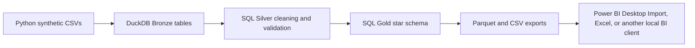

# SaaS Customer Conversion & Lifecycle Funnel Analytics

**Portfolio project 02** — a fully local analytics engineering project that models how B2B SaaS users move from signup to paid subscription, where they stall, and how conversion and revenue vary by acquisition channel and customer segment. 

## Architecture



DuckDB is the local analytical warehouse. The same SQL models run on a laptop, while Gold exports make the results portable to free BI tooling. Power BI Desktop can be used in Import mode without Fabric; publishing and cloud sharing are optional and may require a license.

## Repository layout

```text
├── data/
│   ├── raw/                 # Synthetic source CSVs
│   ├── warehouse/           # Local DuckDB database (generated)
│   └── processed/gold/      # Gold CSV and Parquet exports (generated)
├── dax/                     # Optional Power BI measures
├── screenshots/             # Dashboard evidence
├── app.py                   # Local Streamlit dashboard
├── scripts/
│   ├── generate_saas_data.py
│   └── run_local_pipeline.py
├── sql/
│   ├── 01_silver_cleaning.sql
│   ├── 02_gold_star_schema.sql
│   └── 03_business_analysis.sql
│   └── 04_channel_economics.sql
├── README.md
└── requirements.txt
```

Generated data, the local database, and exports are ignored by Git. The generator is deterministic with its default seed and intentionally introduces quality issues for the cleaning step: duplicate events, null acquisition channels, mixed country casing, and subscription churn. It also creates `monthly_channel_spend.csv` from explicitly synthetic channel-budget assumptions.

## Run locally

From this project directory, with Python 3.9 or newer:

```powershell
python -m pip install -r requirements.txt
python scripts/generate_saas_data.py
python scripts/run_local_pipeline.py --gross-margin-pct 0.75
python -m streamlit run app.py
```

The pipeline creates `data/warehouse/saas_funnel.duckdb` with Bronze, Silver, and Gold tables. It exports `dim_users`, `dim_date`, `fact_funnel_milestones`, and `fact_channel_economics` to `data/processed/gold/` in both CSV and Parquet formats.

The Streamlit app opens locally in your browser and includes two views:

1. **Executive funnel:** stage users, conversion rates, paid conversion, time-to-paid, active ARR, and stage velocity by company size.
2. **Cohorts & channel performance:** monthly signup-cohort conversion, paid conversion by channel, active ARR, and churn.
3. **Channel economics:** mature-cohort spend, CAC by channel, CAC trend, and estimated gross-margin payback.

Use the sidebar to filter by acquisition channel, company size, and signup date. The app reads the local DuckDB Gold tables directly; no Fabric, Power BI, or cloud account is required. You can still open the exported Gold CSVs in Power BI Desktop using **Get Data → Text/CSV** (Import mode), or use the Parquet files in another local BI client.

## Channel economics assumptions

- `monthly_channel_spend.csv` contains one synthetic spend record per month and acquisition channel. It is generated from illustrative baseline budgets with modest seasonality and noise; it is not actual company or advertising-platform spend.
- The `Unknown` channel has zero attributed spend, and its customers are excluded from CAC denominators. A zero-cost unattributed user must not be interpreted as free acquisition.
- Economics are calculated at the channel and signup-month grain. Only **complete signup months** whose full 40-day maximum funnel window has elapsed are included.
- `customer_acquisition_cost = monthly channel spend / paid users from that mature signup-month cohort`.
- Estimated payback is `CAC / (average new-paid-user MRR × gross margin)`. The default gross-margin assumption is **75%**, configurable with `--gross-margin-pct`; this is an estimate and does not model customer-level churn timing.
- ARR and CAC use different time bases (annualized recurring revenue versus cohort-month acquisition cost); do not label ARR divided by spend as ROAS.

## Modeling and data-quality techniques

- Deduplicate events with `ROW_NUMBER()` at the user and event-stage grain.
- Enforce required prior milestones and strictly increasing stage timestamps.
- Normalize country names and replace missing channels with `Unknown`.
- Model users and calendar dates as dimensions, with one row per user and completed stage in the milestone fact.
- Validate row counts, stage order, uniqueness, key coverage, mature-cohort eligibility, CAC math, and payback inputs before exporting.

## Findings from the generated dataset

These are reproducible descriptive findings from the current seeded synthetic dataset, not claims about a real SaaS business. Re-run the queries in `sql/03_business_analysis.sql` to refresh them after generating new data.

- **Largest handoff loss:** 3,389 users reached First Integration and 2,092 reached Paid. That is a 61.7% step conversion and 1,297 users (38.3%) lost at the final handoff. Overall signup-to-paid conversion is 41.8%.
- **Channel differences are narrow in mature cohorts:** among signups dated on or before 2026-10-05 (at least 40 days of observation), conversion ranges from 42.0% for LinkedIn (877 signups) to 44.0% for Organic (1,795). Referral is 43.7% (620) and Paid Search 43.6% (1,313). The small spread does not justify reallocating spend on conversion alone.
- **Mid-Market is a segment to investigate, not a proven problem:** paid conversion is 39.8% for Mid-Market, compared with 40.7% for Enterprise and 43.0% for SMB. Average time from First Integration to Paid is similar across sizes (about 11.3–11.7 days), so the current data does not show a clear velocity bottleneck by company size.
- **Maturity matters:** a signup cohort needs up to 40 days to observe the generated maximum cumulative stage delay. Recent cohorts should not be compared directly with fully observed cohorts.
- **Synthetic economics are illustrative only:** under the configured spend and 75% gross-margin assumptions, seeded blended CAC is about $288 for Organic, $310 for Referral, $642 for Paid Search, and $731 for LinkedIn. Estimated payback ranges from roughly 0.4 to 1.1 months. These are outputs of generated assumptions, not evidence for real budget allocation; actual CAC, payback, and ROAS require real invoices, attribution, and revenue windows.

## Recommended next actions

1. **Investigate the integration-to-paid handoff.** Add tracking for pricing-page views, upgrade prompts, checkout starts, and payment completion, then test an in-product upgrade prompt after the first integration. The current data identifies where users drop, but not why.
2. **Replace the spend assumptions before making channel budget decisions.** Join actual channel/campaign invoices and attribution to signups, and define a revenue observation window before reporting CAC, payback, or ROAS.
3. **Validate segment and retention hypotheses with real data.** Examine Mid-Market packaging and onboarding, and investigate attribution completeness for the small `Unknown` channel group. Use larger real cohorts and retention windows before treating the synthetic differences as causal.

## Project status

- [x] Synthetic relational data generation
- [x] Local DuckDB Bronze/Silver/Gold pipeline and BI-ready exports
- [x] Local interactive Streamlit dashboard
- [x] Mature-cohort channel CAC and estimated payback model
- [x] Findings and actionable recommendations documented
- [ ] Dashboard screenshots

## Portfolio note

This edition deliberately replaces Fabric-specific services with DuckDB so the full data-engineering workflow can be run and reviewed locally at no cost. Fabric Direct Lake is not part of this implementation. The SQL, dimensional modeling, quality checks, and portable Gold data are the core deliverables; a cloud warehouse can be an optional future deployment target.
